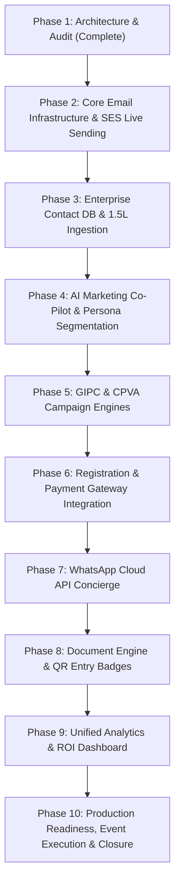

# Master Implementation Plan & Execution Roadmap

**Project:** Enterprise AI-First Email Marketing, Delegate Acquisition & Omnichannel Event Automation Platform  
**Target Events:**  
- **Event 1:** GIPC 2027 (4–5 Feb 2027, T-Hub Hyderabad)  
- **Event 2:** CPVA 3-Day Certification (8–10 Feb 2027, Hyderabad)  
**Contract Baseline Kickoff:** 23 November 2026  
**Current Date:** 25 November 2026 (Week 1 Catch-up)  
**Completion Date:** 12 February 2027  

---

## 1. 10-Phase Engineering Roadmap

---

### Phase 1: Architecture & Audit (Status: COMPLETED)
- Complete repository inspection and verification of running Vercel instance.
- Verified AWS account ID (`132873435443`), IAM user (`JAY`), and region (`ap-south-1`).
- Verified SES production access (50k/day quota, 14/sec send rate).
- Verified DKIM and identities for `updates.globalipconvention.com` and `events.globalipconvention.com`.
- Dispatched and verified live test email delivery.
- Generated `PROJECT_AUDIT.md`, `FEATURE_GAP_ANALYSIS.md`, `IMPLEMENTATION_PLAN.md`, `ENVIRONMENT_CONFIGURATION.md`.

---

### Phase 2: Core Email Infrastructure & Dashboard Sending (Week 1: 25–27 Nov 2026)
- **Objective:** Enable immediate dashboard campaign creation and live test sending using verified AWS SES in `ap-south-1`.
- **Key Tasks:**
  1. Bind Vercel environment variables to `SES_REGION=ap-south-1`, `SES_AWS_ACCOUNT_ID=132873435443`, and AWS credentials.
  2. Set `EMAIL_FROM=updates@updates.globalipconvention.com`.
  3. Ensure MailCheap dashboard displays verified domain `updates.globalipconvention.com` and default configuration set `my-first-configuration-set`.
  4. Implement lifecycle sending quota limiter (enforcing up to 25,00,000 sends over project lifetime).
  5. Configure progressive 14-day warm-up throttling logic.

---

### Phase 3: Enterprise Contact Database & 1.5L List Ingestion (Week 1: 25–26 Nov 2026) — COMPLETED & VERIFIED
- **Objective:** Support high-volume ingestion and segmentation of 1,50,000 records without serverless timeouts or memory bloat.
- **Completed Deliverables:**
  1. Extended `models/Contact.js` schema with enterprise attributes:
     - `firstName`, `lastName`, `fullName`
     - `company`, `designation`, `industry`, `city`, `country`, `phone`
     - `persona` (`IN_HOUSE_COUNSEL`, `LAW_FIRM`, `STARTUP_RND`, `CPVA_PROSPECT`)
     - `gipcStatus` (`NONE`, `INVITED`, `REGISTERED`, `ATTENDED`, `DELEGATE`, `SPEAKER`, `SPONSOR`)
     - `cpvaStatus` (`NONE`, `APPLIED`, `QUALIFIED`, `ENROLLED`, `CERTIFIED`)
     - `intentScore`, `engagementScore` (0–100)
     - Added 8 compound performance indexes for high-speed persona and event filtering.
  2. Built high-performance streaming importer (`lib/streaming-importer.js`):
     - Line-by-line Node.js streaming parser with constant memory (< 215MB RSS).
     - Configurable chunking (1,000 rows) with MongoDB `bulkWrite({ ordered: false })`.
     - Dual-stage deduplication: file-level duplicate tracking and MongoDB in-database matching.
     - Preservation of `Suppression` registry (hard bounces, complaints, unsubscribes).
     - Dry-run simulation mode returning validation counts without database writes.
     - Mid-stream job cancellation support (`/api/contacts/imports/[id]/cancel`).
     - Error report generation (`/api/contacts/imports/[id]/errors`) streaming excluded records as CSV.
  3. Upgraded UI (`components/DialogImportContacts.jsx` & `components/CardImports.jsx`):
     - Field mapping selector for all enterprise attributes.
     - Dry-run toggle switch.
     - Real-time progress bar, live statistics, Cancel button, and downloadable error report link.
  4. Executed Tiered Capacity Verification (`docs/TESTING_REPORT.md`):
     - Tier 1 (10 records): Dry-run & live insert passed.
     - Tier 2 (100 records): Suppression & existing update passed.
     - Tier 3 (1,000 records): Chunk pipeline & error export passed.
     - Tier 4 (10,000 records): Live database insert passed (246 rec/sec, RSS 136MB).
     - Tier 5 (150,000 records): Capacity stress test passed in 48.56s (3,089 rec/sec, RSS 211MB).

---

### Phase 4: AI Marketing Co-Pilot & Persona Segmentation (Week 2: 30 Nov – 2 Dec 2026)
- **Objective:** AI-assisted copywriting and automated contact categorization.
- **Key Tasks:**
  1. Implement AI Co-Pilot client (`lib/ai-copilot.js`):
     - Prompt templates for GIPC 2027 and CPVA 2027 copy generation.
     - A/B subject line generator with spam-word scoring.
     - Persona-specific copy adaptation (Corporate vs. Law Firm vs. Startup).
  2. Implement Persona Segmentation Classifier:
     - Rule-based & keyword mapping engine parsing job titles and corporate domains.
     - Isolate 3 primary GIPC segments and 1 CPVA prospect cohort.

---

### Phase 5: GIPC & CPVA Campaign Engines (Week 2: 3–6 Dec 2026)
- **Objective:** Full multi-touch campaign sequencing with dynamic suppression.
- **Key Tasks:**
  1. Pre-configure the 12 GIPC campaign touchpoints in `models/Campaign.js`:
     - Touchpoint 1: Official Announcement & Super Early Bird.
     - Touchpoint 2: Enterprise Keynote Reveal (TCS, HUL, Philips, Schneider Electric).
     - Touchpoint 3: 48-Hour Super Early Bird Close.
     - Touchpoint 4: 20th Edition Legacy & Global Dialogue.
     - Touchpoint 5: Q4 / Annual Corporate L&D Budget Push.
     - Touchpoint 6: Full 2-Day Agenda & Panel Tracks.
     - Touchpoint 7: 72-Hour Price Hike Warning.
     - Touchpoint 8: High-Intent Plain-Text Secretariat Invite.
     - Touchpoint 9: 7-Days Urgency Alert.
     - Touchpoint 10: Final 48-Hour Last-Call.
     - Touchpoint 11: Post-Event Thank-You & CPVA Walk-in Nudge.
     - Touchpoint 12: Digital Certificate & Presentation Slides.
  2. Implement dynamic suppression filters:
     - Automatically exclude any contact where `gipcStatus === "PAID"` from GIPC discount/promotional campaigns.
     - Exclude `cpvaStatus === "PAID"` from CPVA pitches.

---

### Phase 6: Registration & Payment Gateway Integration (Week 3: 7–10 Dec 2026)
- **Objective:** Ingest real-time payment webhooks with guaranteed idempotency.
- **Key Tasks:**
  1. Create generic payment webhook endpoint: `app/api/webhooks/registration/route.js`.
  2. Implement schema `models/PaymentTransaction.js`:
     - `transactionId`, `registrationId`, `amount`, `currency`, `gateway`, `contactId`, `event` (`GIPC` | `CPVA`), `status` (`SUCCESS`, `FAILED`, `REFUNDED`), `rawPayload`.
  3. Implement HMAC signature verification and idempotency check.
  4. On verified payment success:
     - Update contact status (`gipcStatus = "PAID"` or `cpvaStatus = "PAID"`).
     - Trigger immediate WhatsApp Touchpoint 1 (Receipt/Invoice within 10 seconds).
     - Schedule CPVA cross-sell sequence after 24 hours.
     - Allocate CPVA seat atomically if CPVA registration.

---

### Phase 7: WhatsApp Cloud API Concierge (Week 3: 11–13 Dec 2026)
- **Objective:** Deploy official Meta WhatsApp Cloud API utility automation.
- **Key Tasks:**
  1. Build WhatsApp Cloud API service (`lib/whatsapp.js`):
     - Direct integration with Meta Graph API (`v21.0`).
     - Template-based sending conforming strictly to Meta Utility category.
  2. Implement the 6 Automated Delegate Touchpoints:
     - **Touchpoint 1 (Instant):** Payment confirmation & invoice PDF delivery.
     - **Touchpoint 2 (Instant):** Corporate Approval & Calendar Kit (ICS + Justification letter).
     - **Touchpoint 3 (Jan 5 / T-30):** 2-day session schedule PDF.
     - **Touchpoint 4 (Jan 28 / T-7):** T-Hub Google Maps location pin and partner hotel guide.
     - **Touchpoint 5 (Feb 3 / T-24h):** Scannable VIP QR Entry Badge and WiFi details.
     - **Touchpoint 6 (Feb 6):** Digital Participation Certificate & slide archive.
  3. Webhook receiver for message status (`sent`, `delivered`, `read`, `failed`).

---

### Phase 8: Document Engine & QR Entry Badges (Week 4: 14–20 Dec 2026)
- **Objective:** High-resolution dynamic PDF generation and secure QR entry badges.
- **Key Tasks:**
  1. Build document generator (`lib/document-generator.js`):
     - Invoices & Payment Receipts.
     - Corporate Expense Justification Letters.
     - Calendar block files (`.ics`).
     - GIPC & CPVA Participation Certificates.
  2. Implement QR Entry Badge subsystem:
     - Generate cryptographic HMAC-signed QR token for each paid delegate.
     - Produce printable VIP Badge PDF.
     - Check-in scanner API: `app/api/checkin/scan/route.js` with duplicate scan prevention.

---

### Phase 9: Unified Analytics, ROI & CPVA 25-Seat Scarcity (Week 5: 21–27 Dec 2026)
- **Objective:** Live tracking of campaign funnel, attribution, and strict cohort locking.
- **Key Tasks:**
  1. Implement atomic CPVA 25-Seat Manager:
     - Hard limit of 25 paid seats with atomic MongoDB lock.
     - Real-time remaining seat counter displayed on dashboard.
     - Scarcity triggers ("Final 8 Seats", "Last 3 Seats").
  2. Unified Analytics Dashboard:
     - Email funnel: Sends, Deliveries, Opens, Clicks, Bounces, Unsubscribes.
     - WhatsApp funnel: Queued, Sent, Delivered, Read.
     - Conversion & Revenue: Registrations, Paid Revenue (GIPC vs. CPVA), CPA, ROI.

---

### Phase 10: Production Readiness, Event Execution & Closure (Jan – 12 Feb 2027)
- Pre-event load tests and security review.
- Live GIPC event week badge scanning support (4–5 Feb 2027).
- Post-GIPC certificate and presentation delivery (6 Feb 2027).
- CPVA 3-Day Certification cohort delivery (8–10 Feb 2027).
- Clean engaged-audience export and final project handover (12 Feb 2027).

---

## 2. Catch-up Implementation Schedule

| Week | Date Range | Primary Focus | Milestones |
| :--- | :--- | :--- | :--- |
| **Week 1** | **23 – 29 Nov 2026** | **Setup & IP Warm-Up** | Architecture audit complete; SES live sending verified; Database schema extended; Initial 50,000 active contact warm-up launched. |
| **Week 2** | **30 Nov – 6 Dec 2026** | **Full List Launch** | 1,50,000 contacts loaded & cleaned; Official GIPC Announcement sent in throttled batches; CPVA 25-Seat Announcement to valuation segment. |
| **Week 3** | **7 – 13 Dec 2026** | **Keynote Reveal & Payment Webhooks** | Enterprise speaker spotlight (TCS, HUL, Philips); Payment gateway webhooks connected; WhatsApp Touchpoint 1 (Instant Receipt) active. |
| **Week 4** | **14 – 20 Dec 2026** | **Super Early Bird Close** | 48-Hour countdown to non-buyers; Dynamic suppression verified; Justification kit generator online. |
| **Week 5** | **21 – 27 Dec 2026** | **20th Edition Legacy** | Year-end corporate group offer; First weekly attribution and conversion report delivered. |
| **Week 6** | **28 Dec – 3 Jan 2027** | **New Year Budget Push** | Q4/Annual legal L&D budget campaign; CPVA warm-clicker wave. |
| **Week 7** | **4 – 10 Jan 2027** | **Full Agenda Release** | Complete 2-day T-Hub tracks released; T-30 Days WhatsApp agenda PDF pushed to confirmed delegates. |
| **Week 8** | **11 – 17 Jan 2027** | **Standard Tier Cutoff** | 72-Hour price hike alert; CPVA "Final 8 Seats" alert; Milestone 2 billing. |
| **Week 9** | **18 – 24 Jan 2027** | **High-Intent Retargeting** | Plain-text personal invitation from Secretariat; WhatsApp travel and hotel guide dispatched. |
| **Week 10** | **25 – 31 Jan 2027** | **Final 7 Days Urgency** | "7 Days to GIPC at T-Hub" alert; CPVA "Last 3 Seats" final registration closure. |
| **Week 11** | **1 – 7 Feb 2027** | **GIPC Event Week** | VIP QR badges delivered via WhatsApp; GIPC live event at T-Hub (4–5 Feb); Post-event certificates sent (6 Feb). |
| **Week 12** | **8 – 12 Feb 2027** | **CPVA Workshop & Closure**| CPVA 3-Day workshop (8–10 Feb); Completion certificates issued; Final audience handover and project closure (12 Feb). |
